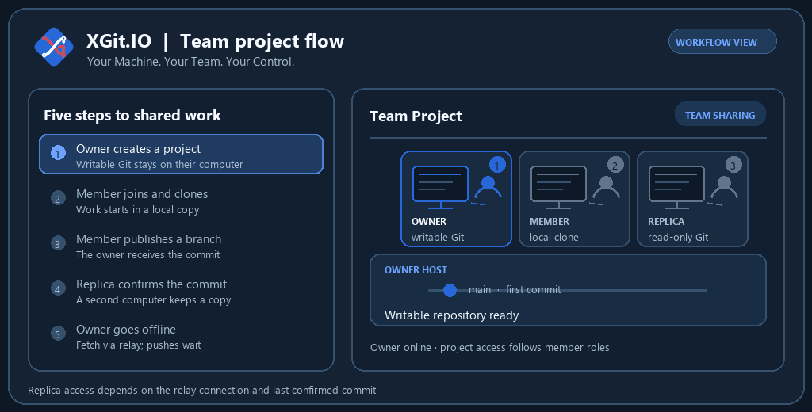
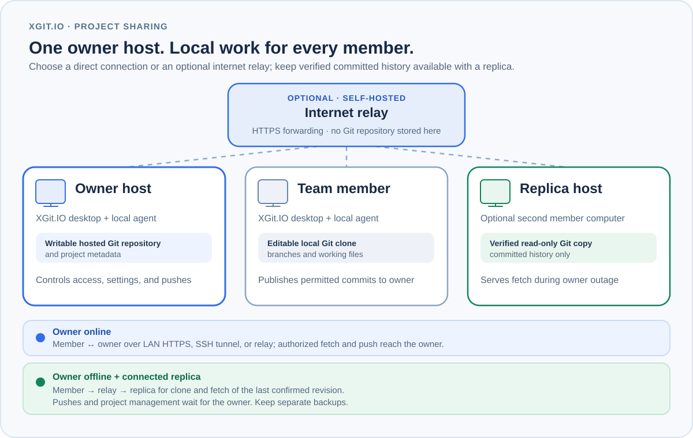
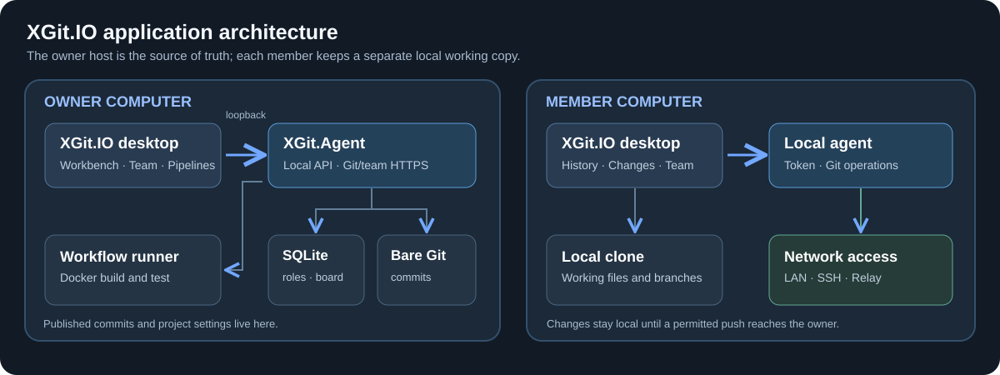
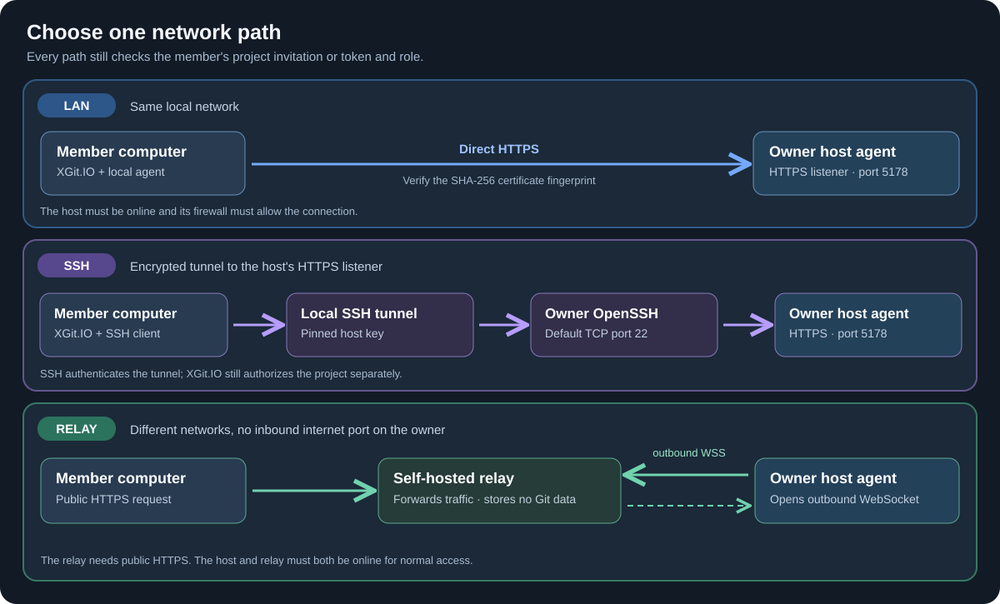
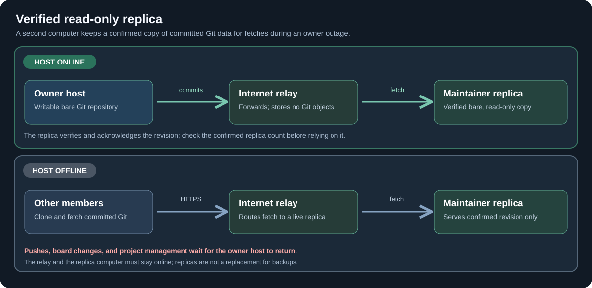

<h1 align="center">XGit.IO</h1>

<strong>Your Machine. Your Team. Your Control.</strong>

**XGit.IO is free to download and use for individuals, teams, and businesses. No purchase or subscription is required.**

  
  
  

XGit.IO is a desktop workspace for teams that want to work together without moving their primary Git repository to someone else's hosting account. The project owner runs the writable host on their computer. Teammates clone the project, commit locally, and publish work according to their project role. The same app shows history, changes, branches, project tasks, and workflow stages.

The owner chooses how teammates connect: on a local network, through an SSH tunnel, or through a relay they operate. A second computer can keep a verified, read-only copy of committed history so teammates can continue fetching during an owner-host outage.

## Download

| Computer | Release file | Install |
| --- | --- | --- |
| Windows x64 | [XGit-Setup-Windows-x64.exe](https://github.com/Ethan0007/XGit.IO/releases/tag/v0.1.0-beta) | Run the setup program. It installs XGit.IO for the current Windows user. |
| Mac with Apple Silicon | [XGit-macOS-arm64.dmg](https://github.com/Ethan0007/XGit.IO/releases/tag/v0.1.0-beta) | Open the DMG and drag **XGit.IO.app** to **Applications**. |

Both downloads are in the [v0.1.0-beta release](https://github.com/Ethan0007/XGit.IO/releases/tag/v0.1.0-beta), along with SHA-256 checksums. Install Git on every computer that will work with repositories. Docker with a running Linux engine is needed only on computers that run build and test workflows. Azure CLI and deployment access are needed on the owner host when Azure deployment is configured.

The Windows installer is unsigned. The macOS app has an ad-hoc integrity signature and is not notarized by Apple, so macOS may require explicit approval. Keep a separate backup of important repositories and [read the current limits](#security-and-current-limits) before using the beta for critical work.

### macOS: install and open for the first time

The Apple Silicon download supports M-series Macs, including M4. This beta is not notarized by Apple. On first launch, macOS may show **“XGit.IO” Not Opened** and say that Apple could not verify the app is free of malware.

1. Download **XGit-macOS-arm64.dmg** from this repository's [release page](https://github.com/Ethan0007/XGit.IO/releases/tag/v0.1.0-beta).
2. Open the DMG and drag **XGit.IO.app** into **Applications**. Replace the previous app if you installed an earlier beta.
3. Open **XGit.IO** from **Applications**.
4. If the verification warning appears, click **Done**.
5. Open **System Settings > Privacy & Security**, scroll to **Security**, and find the message about XGit.IO being blocked.
6. If you trust the download, click **Open Anyway**, authenticate if asked, and confirm **Open**.

macOS saves this approval for the app. If **Open Anyway** is missing, try opening XGit.IO from Applications again, then return to Privacy & Security. On an organization-managed Mac, ask your IT administrator if approval is restricted. See [Apple's instructions for opening downloaded apps](https://support.apple.com/en-us/102445).

If the message instead says the app **is damaged** or **will damage your computer**, stop and report the exact message in [Issues](https://github.com/Ethan0007/XGit.IO/issues). These steps apply to the unverified-app warning above.

## See a team project move

The numbered computers follow an owner, a member, and a replica. When the owner is offline, a connected replica can answer read-only clone and fetch requests for commits it has confirmed. Publishing waits for the owner to reconnect.

## How the pieces fit

The owner's machine holds the writable bare Git repository and the project metadata: invitations, roles, tasks, network settings, and pipeline settings. Each member's working files stay in their own local clone. A push sends committed work to the owner host; uncommitted files do not travel with Git.

The relay is an optional transport for teams on different networks. It forwards requests and WebSocket traffic but does not store Git objects. A replica is different from a teammate's editable clone: it is a separate, verified bare copy of committed history on a Maintainer's computer.

| Component | Where it runs | What it does |
| --- | --- | --- |
| Desktop app and local agent | Every participating computer | Workbench, local Git operations, project connection, and status |
| Writable Git host | Owner's computer | Accepts authorized pushes and holds project settings |
| Local clone | Member's computer | Holds editable files, branches, and local commits |
| Internet relay (optional) | A public HTTPS server chosen by the owner | Connects remote clients to the host; holds no repository |
| Verified replica (optional) | A Maintainer's computer | Serves confirmed commits for read-only fetch while the owner is offline |

## Connect your team

| Connection | Good fit | Check before joining |
| --- | --- | --- |
| LAN HTTPS | Computers on the same local network | Verify the owner's SHA-256 certificate fingerprint through a separate channel. |
| SSH tunnel | The owner host is reachable over SSH | Verify the host's SSH public key; XGit.IO also pins the HTTPS certificate inside the tunnel. |
| Internet relay | Computers on different networks without a direct route | Use a trusted public HTTPS endpoint and a project invitation or saved member token. |

All three paths lead to the owner's project agent. The connection carries traffic; project roles decide who can fetch or push. An invitation grants access to one project, is single-use, and expires after 30 minutes. The owner can revoke project access later. Revocation blocks future server requests but cannot erase a clone already on another computer.

### First project

1. Install XGit.IO on the owner computer. Create a workspace and project, then save the one-time owner token.
2. In the project's **Team** area, invite a member and select their role. Share the invitation privately.
3. Enable LAN access, configure an SSH tunnel, or connect a self-hosted relay. Give the member the relevant address and trust information.
4. On the member computer, install XGit.IO, verify the connection, accept the invitation, and choose **Clone project** or **Link existing clone**.
5. Work in local branches. Commit, then publish a permitted branch to the owner host.

The app's **Help** menu includes the Terms and Conditions and Privacy Policy. On first run, each user can read them before accepting or canceling setup.

## Keep committed history available

A Maintainer can enable a replica on a second computer through the relay. XGit.IO fetches a bare copy, verifies it, and reports the confirmed revision to the owner. The owner can see how many replicas have confirmed the current revision.

If the host goes offline, a connected replica can serve clone and fetch up to its last confirmed revision. It cannot accept pushes, change project settings, or approve work on the owner's behalf. The relay and replica both need to stay online. This is access to committed history during an outage, not automatic leader election or a replacement for backups.

## Builds and deployments

XGit.IO can build and test supported static frontends and API projects in Docker, then show the result in workflow stages. An Admin can run a manual build on their own machine after fetching the branch. If the owner is offline, the Admin's result and artifact stay local until reconnection. The owner host checks the Admin role, branch commit, and committed workflow before accepting the result.

Azure targets and credentials stay on the owner host. The owner decides whether staging and production deployments require approval; Admins cannot change that policy. When approval is required, the owner can approve the built artifact and deployment continues without rebuilding. Without a required approval, a valid deployment proceeds automatically once the owner host can deploy it.

## Review changes before merging

Open a pull request from a branch in the sidebar or Branches tab. Reviewers can inspect the diff, discuss specific files and lines, and approve or request changes inside XGit.IO. The Conflicts tab shows conflicting code from both branches with its original line numbers.

Protected branches reject direct pushes. Merging requires current independent approval, resolved required discussions, no merge conflicts, and a passing build of the proposed merged result. New commits or policy changes invalidate earlier approvals and build results. These checks run on the owner host, which must be online. Read the [pull-request guide](docs/PULL-REQUESTS.md) for reviewer roles and branch protection.

## Security and current limits

- The local management API binds to loopback. LAN access uses HTTPS and exposes only the project network endpoints.
- Project invitations are random, single-use, and time-limited. Member tokens are stored as hashes on the host. A role is checked before Git or team data is served.
- The relay terminates HTTPS and can see forwarded Git traffic and member tokens. Operate it only on infrastructure you trust. It does not store repository content.
- A shared Git repository includes its committed history, including files deleted in later commits. Review tracked files and history before inviting people. Local uncommitted work stays local unless a user enables the separate working-change preview.
- A replica holds only commits it has confirmed. A revocation made just before an outage may not reach it immediately; an existing access ticket can remain usable for up to 24 hours.
- Pushes and project management need the owner host. There is no automatic write failover or offline push queue.
- The Windows installer is unsigned. The macOS app is ad-hoc signed and unnotarized. Operating-system security prompts may appear.

The architecture diagrams describe roles and connections; they contain no live credentials. Keep owner tokens, member tokens, relay keys, and private SSH keys out of public issues and screenshots. For security reports, contact [dev@xgit.io](mailto:dev@xgit.io).

## About this release

This public repository contains documentation and installer downloads. The application source code remains private. See the [free-use license](LICENSE.txt), [Terms and Conditions](docs/TERMS.txt), and [CHANGELOG.md](CHANGELOG.md). Cloud hosting and other third-party services you choose may have their own charges.

Created by [Joever Monceda on LinkedIn](https://www.linkedin.com/in/joever-monceda-55242779/) · [GitHub](https://github.com/Ethan0007/)
